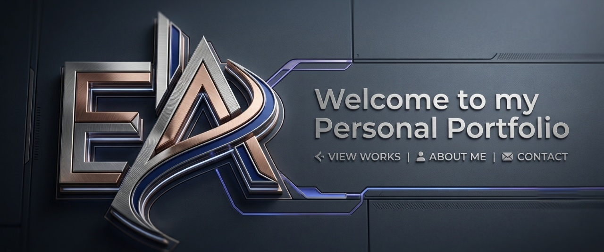

<p align="center">
  
</p>

# Egabo Aaron — Portfolio

[](mailto:aaronegabo@gmail.com) [](https://github.com/EGABO-TECH) [](https://www.linkedin.com/in/egaboaaron) [](https://x.com/WanEgabo)

A cinematic, high-contrast portfolio built to feel less like a résumé and more like a curated statement of craft. This project showcases my work as a software engineer who builds thoughtful digital products for real-world problems — from education and health tech to civic infrastructure and emerging markets.

## What this site is

This portfolio is designed to communicate three things at once:

- who I am as a builder
- what kinds of systems I enjoy creating
- how I think about product, performance, and clarity

It blends editorial design, motion, and modern web technology to present complex ideas in a way that feels clean, intentional, and memorable.

## What you’ll find here

- a bold hero experience with immersive motion
- featured projects with technical context and links
- a skills overview that reflects my engineering focus
- social and contact channels for collaboration or conversation

## Tech stack

This site is built with a modern front-end stack:

- React 19 + TypeScript
- Vite
- Framer Motion for polished animation
- Tailwind CSS for layout and visual structure
- Three.js / React Three Fiber for richer visual experiences
- WebGL Fluid for the interactive background effect
- Lucide icons for the interface system

## Project structure

```text
src/
├── App.tsx               # Main portfolio layout and view logic
├── components/           # Hero, skills, social, and content sections
├── lib/                  # Motion and animation helpers
├── assets/               # Branding, imagery, and visual resources
└── utils/                # Fluid and supporting utility logic
```

## Getting started

### Prerequisites

- Node.js 18+
- npm or pnpm

### Install and run locally

```bash
git clone https://github.com/EGABO-TECH/Portfolio-Rework.git
cd Portfolio-Rework
npm install
npm run dev
```

Then open the local URL shown in your terminal.

## Build and preview

```bash
npm run build
npm run preview
npm run lint
```

## Contact

If you want to talk about software, product thinking, systems design, or collaboration, I’d love to hear from you.

-  Email: [aaronegabo@gmail.com](mailto:aaronegabo@gmail.com)
-  GitHub: [EGABO-TECH](https://github.com/EGABO-TECH)
-  LinkedIn: [egaboaaron](https://www.linkedin.com/in/egaboaaron)
-  X: [@WanEgabo](https://x.com/WanEgabo)

© 2026 Egabo Aaron. All rights reserved unless otherwise stated.
